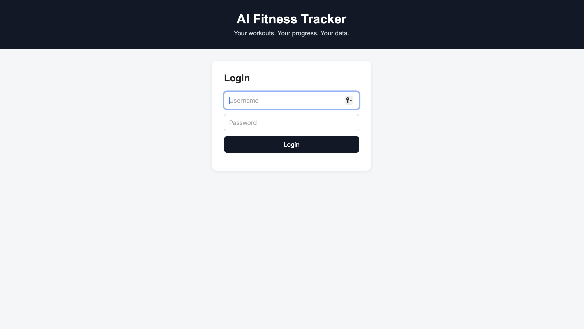

# AI Fitness Tracker

A full-stack fitness tracking application built to help users record workouts, monitor training progress, and receive AI-powered workout recommendations.

## Features

- **Workout Management:** Add, edit, and delete workout entries.
- **Workout History:** View past workouts, exercises, and training dates.
- **Progress Analytics:** Track workout counts, sets, reps, and training volume.
- **Progress Charts:** Visualize performance by exercise over time.
- **Workout Calendar:** View training activity by date.
- **AI Workout Recommendations:** Get workout insights and training suggestions.

## Technologies Used

- **Backend:** Python, FastAPI
- **Database:** PostgreSQL, SQLAlchemy
- **Frontend:** HTML, CSS, JavaScript
- **Data Visualization:** Chart.js
- **AI Integration:** OpenAI API

## What I Learned

- Building API endpoints with FastAPI
- Connecting a Python application to PostgreSQL
- Implementing create, read, update, and delete (CRUD) operations
- Creating interactive charts and workout analytics
- Integrating AI-powered recommendations
- Managing project files and version control with Git and GitHub

## Running the Project Locally

### Prerequisites
- Python 3.13 or a compatible Python version
- PostgreSQL
- An OpenAI API key for AI-powered features

### Setup

1. Clone the repository:

   ```bash
   git clone https://github.com/kani4prezzzz/ai-fitness-tracker.git
   cd ai-fitness-tracker
   ```

2. Create and activate a virtual environment:

   ```bash
   python3 -m venv .venv
   source .venv/bin/activate
   ```

3. Install dependencies:

   ```bash
   pip install -r requirements.txt
   ```

4. Create your environment configuration:

   ```bash
   cp .env.example .env
   ```

   Open `.env` and replace the placeholder values with your own `OPENAI_API_KEY` and a long, randomly generated `SECRET_KEY`. Never commit your actual `.env` file or share your secrets.

5. Create a PostgreSQL database named `fitness_tracker` and configure the database connection in `database.py` if your local PostgreSQL username or setup differs.

6. Start the application:

   ```bash
   uvicorn main:app --reload
   ```

7. Open the dashboard in your browser:

   http://127.0.0.1:8000/frontend/index.html

   API documentation is available at http://127.0.0.1:8000/docs.

## Running Tests

Run the automated test suite with:

```bash
python -m pytest -v
```

The tests cover authentication, input validation, and user-specific workout data access.

## Security

- Keep API keys and secret values in your local `.env` file.
- Never commit real credentials to GitHub.
- Use `.env.example` as a template with placeholder values only.

## Author

Kani Smith

## Dashboard Preview


